# 🚀 Remote PC: Host & Control Remoto para Terminal y Claude Code

[](https://golang.org)
[](https://microsoft.com)
[](https://developer.android.com)
[]()
[]()

**Remote PC** es una suite completa de desarrollo remoto y control de terminal diseñada específicamente para ejecutar, supervisar y controlar **Claude Code** y shells interactivas de tu PC Windows directamente desde tu **teléfono Android** o desde un **Dashboard Web en tiempo real**.

Sin servidores en la nube de terceros, sin telemetría y con latencia ultra baja en red local (LAN) o VPN privada (Tailscale).

---

## 🌟 Características Principales

### 🖥️ Windows Pseudo Console (ConPTY) Nativo
- Emulación de terminal raw completa en Windows a través de la API oficial `CreatePseudoConsole` de Windows (`kernel32.dll`).
- Soporte íntegro para secuencias de escape ANSI, colores de 24 bits, menús interactivos, spinners y cursores dinámicos de **Claude Code**.
- Persistencia de sesiones estilo **tmux**: los procesos continúan ejecutándose en tu PC en segundo plano aunque cierres la app del teléfono o pierdas la conexión Wi-Fi temporalmente.
- Búfer circular de terminal (64 KB configurable) que envía instantáneamente el historial reciente a cualquier cliente al reconectar.

### 📱 Aplicación Móvil Android (100% Nativa)
- Construida en **Kotlin** con **Jetpack Compose** y **Material Design 3**.
- **Barra de Atajos Especializada para Claude Code**:
  - Teclas que no existen en los teclados móviles estándar: `ESC`, `TAB`, `CTRL+C` (cancelar/interrumpir prompt), `CTRL+D`, flechas de navegación (`↑`, `↓`, `←`, `→`) y `ENTER`.
  - Botones de acción rápida con un solo toque: `✓ YES / y`, `✗ NO / n`, `/cost`, `/compact`, `/help`, `/clear`.
- **Explorador de Archivos Remoto**: Navega por los discos y carpetas de tu PC desde el móvil para crear sesiones en la ruta exacta de cualquier proyecto.
- **Auto-scroll y Desplazamiento Fluido**: Sigue automáticamente la salida generada por Claude Code y permite scroll manual suave por todo el buffer histórico.
- **Control de Windscribe VPN Integrado**: Monitoreo de estado en vivo, cambio de locaciones y protocolos con un solo toque.

### 🌐 Desktop Web Dashboard Embebido (`http://localhost:8080/`)
- Interfaz web moderna servida directamente por el binario de Go (`embed.FS`).
- **Live Terminal Mirror**: Espejo en tiempo real de cualquier sesión activa utilizando **xterm.js**, permitiendo escribir prompts e interactuar en simultáneo con el teléfono.
- **Monitor de Conexiones Activas**: Visualiza qué dispositivos móviles están conectados en tiempo real con su dirección IP y tiempo de conexión.
- **Panel de Estadísticas**: Uso de recursos, tiempo de actividad (uptime), sesiones activas y emparejamiento rápido por token / JSON.

### 🛡️ Integración Nativa con Windscribe VPN
- Diseñado para superar bloqueos geográficos de Claude Code (errores HTTP 403 Forbidden).
- **Selector de Locaciones**: Conexión a *Best Location (Auto)*, *Miami*, *New York*, *Dallas*, *Chicago*, *Los Angeles*, *Seattle*, *Toronto*, *London*, *Frankfurt*, *Paris*, *Amsterdam* o cualquier ciudad/código personalizado.
- **Selector de Protocolos**: *WireGuard* (más rápido), *Stealth:443* (anti-DPI / TLS ofuscado), *OpenVPN UDP*, *OpenVPN TCP*, *WSTunnel* e *IKEv2*.
- **Cambio en Caliente (On-the-fly Switch)**: Cambia de servidor o protocolo sin necesidad de desconectarte manualmente primero.
- **Priorización de IP Física**: El servidor detecta y filtra adaptadores virtuales para que la app del móvil siempre apunte a tu IP Wi-Fi física (`192.168.x.x`), manteniendo la comunicación teléfono-PC intacta (con *Allow LAN Traffic* activo en Windscribe).

---

## 🏛️ Arquitectura del Sistema

```mermaid
flowchart TD
    subgraph PC["🖥️ Workstation Windows (Host)"]
        subgraph ServerDaemon["remotepc-server (Go Backend)"]
            ConPTY["ConPTY Engine (kernel32.dll)"]
            SessionMgr["Session Manager (tmux-style persist)"]
            RingBuf["Ring Buffer (History)"]
            WsServer["WebSocket Server (/ws/session/:id)"]
            RestAPI["REST API (/api/...)"]
            WebDash["Embedded Web Dashboard (xterm.js)"]
            VpnMgr["Windscribe VPN Controller (CLI Bridge)"]
        end

        ClaudeCLI["🤖 Claude Code CLI / PowerShell"]
        WindscribeApp["🛡️ Windscribe Service & CLI"]
        ConPTY --> ClaudeCLI
        VpnMgr --> WindscribeApp
    end

    subgraph Mobile["📱 Dispositivo Android (Cliente)"]
        ComposeUI["Jetpack Compose UI (Material 3)"]
        TermView["Terminal Screen + Smooth Scroll"]
        ClaudeBar["Claude Shortcut Bar (ESC, Tab, Ctrl+C, Yes/No)"]
        VpnCard["VPN Controller Card (Locations & Protocols)"]
        ApiClient["OkHttp / Coroutines WebSocket Client"]
    end

    ApiClient <-->|Local Wi-Fi / Tailscale| WsServer
    ApiClient <-->|HTTP REST Requests| RestAPI
    WebDash <-->|Local Mirror| WsServer
```



---

## 📁 Estructura del Repositorio

```
Remote PC/
├── server/                     # Servidor Daemon en Go
│   ├── cmd/server/             # Punto de entrada (main.go)
│   ├── internal/
│   │   ├── api/                # Enrutador HTTP REST y WebSocket
│   │   ├── config/             # Carga y persistencia de configuración
│   │   ├── pty/                # Windows ConPTY API (CreatePseudoConsole)
│   │   ├── session/            # Gestor de procesos, buffer circular y clientes
│   │   ├── vpn/                # Integración con Windscribe CLI
│   │   └── web/                # Dashboard Web embebido (HTML/CSS/JS + xterm.js)
│   └── README.md
├── android/                    # Cliente Nativo Android (Kotlin + Compose)
│   ├── app/src/main/java/com/remotepc/app/
│   │   ├── data/
│   │   │   ├── model/          # Modelos de Sesión, VPN y Directorios
│   │   │   └── network/        # ApiClient, WebSocket y AppConfig
│   │   ├── ui/
│   │   │   ├── components/     # Barra de atajos para Claude Code
│   │   │   ├── dialogs/        # Diálogo para crear sesiones y selector de carpetas
│   │   │   ├── sessions/       # Pantalla principal y tarjeta de VPN interactiva
│   │   │   ├── settings/       # Pantalla de configuración y prueba de conexión
│   │   │   ├── terminal/       # Vista de terminal con scroll interactivo
│   │   │   └── theme/          # Paleta de colores Dark Terminal
│   │   └── AndroidManifest.xml
│   ├── build.gradle.kts
│   └── README.md
├── start-server.bat            # Script de inicio rápido en Windows
├── server.config.json.example  # Plantilla de configuración del servidor
├── .gitignore
└── README.md
```

---

## ⚡ Guía de Inicio Rápido

### 1. Requisitos Previos

* **En la PC**:
  * Windows 10 (Build 1809+) o Windows 11.
  * [Go 1.22+](https://go.dev/dl/) instalado.
  * [Claude Code](https://docs.anthropic.com/en/docs/agents-and-tools/claude-code/overview) (`npm install -g @anthropic-ai/claude-code`).
  * *(Opcional)* [Windscribe VPN](https://windscribe.com/) instalado en Windows con la opción **Allow LAN Traffic** activada en sus preferencias.
* **En el Móvil**:
  * Teléfono o tablet con **Android 8.0 (API 26)** o superior.
  * Conectado a la misma red Wi-Fi que la PC (o conectado a tu VPN de Tailscale).

---

### 2. Iniciar el Servidor en Windows

1. Clona el repositorio:
   ```bash
   git clone https://github.com/TU_USUARIO/Remote-PC.git
   cd "Remote PC"
   ```

2. Ejecuta el script de inicio rápido:
   ```cmd
   start-server.bat
   ```
   *O compila e inicia manualmente:*
   ```powershell
   cd server
   go build -ldflags="-s -w" -o ..\remotepc-server.exe .\cmd\server
   cd ..
   .\remotepc-server.exe -open
   ```

3. El servidor se iniciará en `http://localhost:8080/` y mostrará en consola:
   ```
   =====================================================
          Remote PC Daemon - Terminal & Claude Host     
   =====================================================
    Listening on : 0.0.0.0:8080
    Dashboard UI : http://localhost:8080/
    Auth Token   : 387fca53171520740b591975dcaec681
   -----------------------------------------------------
    Connect from Android with:
      Host/IP : 192.168.x.x
      Port    : 8080
      Token   : 387fca53171520740b591975dcaec681
   =====================================================
   ```

---

### 3. Compilar e Instalar la App Android

Si dispones de Android Studio o el Android SDK configurado:

```bash
cd android
./gradlew assembleDebug
adb install -r app/build/outputs/apk/debug/app-debug.apk
```

---

### 4. Emparejar el Teléfono con la PC

1. Abre la aplicación **Remote PC** en tu teléfono Android.
2. Toca el icono de **Ajustes** (engranaje) en la barra superior.
3. Ingresa los datos mostrados por tu servidor:
   * **Host / IP**: La IP LAN de tu PC (ej. `192.168.68.54`).
   * **Puerto**: `8080`.
   * **Auth Token**: Tu token seguro.
4. Toca **Test Connection** para verificar la comunicación y luego **Save & Return**.

---

### 5. Lanzar Sesiones de Claude Code

1. En la pantalla principal de la app, pulsa el botón flotante **`+`**.
2. **Nombre de sesión**: Ingresa un alias (ej. `Mi Proyecto`).
3. **Directorio de trabajo (CWD)**: Toca el icono de carpeta para navegar visualmente por las carpetas de tu PC y elegir tu proyecto.
4. **Comando**:
   * Selecciona el preset **Claude Code** (`claude`), o
   * Usa una shell directa (`powershell.exe` / `cmd.exe`).
5. Pulsa **Create Session**. ¡Tu sesión de Claude Code comenzará a transmitirse en vivo con todos sus colores, opciones interactivas y atajos móviles listos para usar!

---

## 🛡️ Control de Windscribe VPN

Tanto en la parte superior de la aplicación Android como en la columna lateral del Dashboard Web dispones de una tarjeta dedicada a **Windscribe VPN**:

| Control | Descripción |
| :--- | :--- |
| **Indicador Luminoso** | **Verde**: Túnel activo y cifrado. **Gris**: Desconectado / Conexión directa. **Ámbar**: En proceso de conexión. |
| **Detalles del Túnel** | Muestra en vivo la ciudad conectada, IP pública asignada y protocolo activo (ej. `Miami - Vice · 135.136.5.74 · Stealth:443`). |
| **Desplegable de Ajustes (`Tune` / `^`)** | Permite seleccionar entre múltiples ciudades de USA, Canadá, Europa y Asia, o escribir una ciudad personalizada. |
| **Selector de Protocolos** | Permite elegir entre WireGuard, Stealth:443, OpenVPN UDP/TCP, WSTunnel e IKEv2. |
| **⚡ Apply & Switch** | Permite cambiar de locación o protocolo directamente sobre la marcha sin necesidad de desconectarse primero. |

> [!IMPORTANT]
> Para que el teléfono continúe comunicándose con la PC por Wi-Fi mientras el VPN está conectado, debes habilitar la opción **Allow LAN Traffic** en Windscribe:
> `Windscribe > Preferencias (⚙️) > Connection > Allow LAN Traffic: ON`.

---

## ⚙️ Configuración del Servidor (`server.config.json`)

Puedes personalizar los parámetros del servidor creando un archivo `server.config.json` en la raíz (puedes basarte en `server.config.json.example`):

```json
{
  "port": "8080",
  "authToken": "tu_token_secreto_personalizado",
  "host": "0.0.0.0",
  "defaultShell": "powershell.exe",
  "maxHistoryKB": 64
}
```

* **`port`**: Puerto de escucha HTTP/WebSocket (por defecto: `8080`).
* **`authToken`**: Token Bearer de seguridad. Si se omite, se generará uno aleatorio de 128 bits al iniciar.
* **`host`**: Interfaz de enlace (`0.0.0.0` para escuchar en toda la red local).
* **`defaultShell`**: Shell predeterminada (`powershell.exe`, `cmd.exe`, `bash.exe`).
* **`maxHistoryKB`**: Tamaño máximo del búfer circular por sesión (en KB).

---

## 📡 Referencia de la API REST y WebSockets

Todos los endpoints (excepto `/api/health` y `/`) requieren la cabecera `Authorization: Bearer <TOKEN>` o el parámetro `?token=<TOKEN>`.

### Sesiones de Terminal
* `GET /api/sessions`: Devuelve la lista de sesiones activas (ID, nombre, CWD, PID, estado de ejecución, timestamp).
* `POST /api/sessions`: Crea una nueva terminal ConPTY.
  * *Body*: `{"name": "Claude", "cwd": "C:\\Proyectos", "command": "claude", "cols": 100, "rows": 30}`
* `DELETE /api/sessions/{id}`: Termina el proceso y libera los recursos de la consola virtual.
* `WS /ws/session/{id}`: Conexión WebSocket bidireccional para transmisión binaria de entrada/salida de terminal y redimensionamiento dinámico.

### Sistema de Archivos
* `GET /api/fs/directories?path=C:\`: Explora las subcarpetas del sistema para el selector visual de directorios.

### Windscribe VPN
* `GET /api/vpn/status`: Devuelve el estado actual de la conexión VPN (`installed`, `connected`, `state`, `location`, `ip`, `protocol`, `firewall`).
* `GET /api/vpn/options`: Devuelve el catálogo de locaciones recomendadas y protocolos soportados con sus puertos.
* `POST /api/vpn/connect`: Conecta al VPN con parámetros opcionales `{ "location": "Miami", "protocol": "stealth", "port": "443" }`.
* `POST /api/vpn/disconnect`: Desconecta el túnel VPN.

### Servidor y Diagnóstico
* `GET /api/server-info`: Devuelve hostname, uptime, IPs locales físicas, estado de VPN y contador de clientes conectados.
* `GET /api/connections`: Lista los dispositivos actualmente conectados al servidor (IP, User-Agent, sesión asociada).
* `GET /api/health`: Comprobación rápida de disponibilidad (`status: ok`).

---

## 🔒 Seguridad y Privacidad

* **Totalmente Autónomo**: Ningún dato de tus proyectos, comandos de terminal o claves de Claude viaja a servidores externos; todo permanece estrictamente dentro de tu red local.
* **Tokens Criptográficos**: Todas las llamadas de la API REST y WebSockets están autenticadas con tokens Bearer generados aleatoriamente o configurados por el usuario.
* **Aislamiento de Interfaces**: El servidor filtra los adaptadores de red virtuales (Windscribe, TAP, WSL, Hyper-V) para asegurar que solo se expongan las interfaces Wi-Fi/Ethernet físicas de tu PC.

---

## 📄 Licencia

Este proyecto está bajo la Licencia **MIT**. Consulta el archivo `LICENSE` para más detalles.
