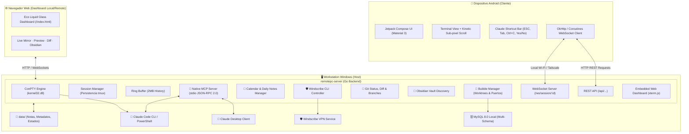

<div align="center">

# 🚀 Remote PC

### Centro de Operaciones de Ingeniería, Host ConPTY y Servidor AI MCP Nativo

[](https://github.com/joseyx/remote-pc/actions/workflows/ci.yml)
[](https://golang.org)
[](https://developer.android.com)
[](https://modelcontextprotocol.io/)
[](https://microsoft.com)
[](dist/RemotePC-Setup.exe)
[](LICENSE)

<p align="center">
  <b>Controla Claude Code, terminales interactivas de Windows y flujos multi-proyecto desde tu teléfono Android o navegador web.</b><br>
  Integración nativa con <b>Model Context Protocol (MCP)</b>, Git Worktrees, bóvedas de Obsidian, bases de datos multi-esquema y Windscribe VPN.
</p>

[Instalación Rápida](#-instalación-rápida) •
[Integración MCP](#-servidor-mcp-nativo-para-agentes-ia) •
[Características](#-características-principales) •
[Arquitectura](#-arquitectura-del-sistema) •
[Comandos CLI](#-comandos-cli-de-remotepc-server) •
[App Android](#-aplicación-móvil-android) •
[API REST & WS](#-referencia-de-la-api-rest-y-websockets)

---

</div>

## 💡 ¿Qué es Remote PC?

**Remote PC** es una suite completa de desarrollo remoto diseñada para eliminar la fricción al trabajar con herramientas de inteligencia artificial (**Claude Code**, Antigravity) y proyectos de software complejos con múltiples ramas y worktrees. 

A diferencia de clientes SSH genéricos que rompen cursores y colores ANSI en Windows, Remote PC emula consolas interactivas mediante la API oficial **Windows Pseudo Console (ConPTY)**, persistiendo sesiones en segundo plano al estilo tmux con búfer circular de 2 MB y permitiendo la interacción bidireccional desde **Android**, **Web** y **Agentes de IA**.

> [!TIP]
> **100% Autónomo y Privado:** Sin servidores en la nube de terceros, sin telemetría y con latencia ultrabaja en red local (Wi-Fi) o redes privadas virtuales (Tailscale).

---

## ⚡ Instalación Rápida

### Opción 1: Instalador Gráfico de Windows (Recomendada para usuarios)
1. Descarga el instalador compilado [`dist/RemotePC-Setup.exe`](dist/RemotePC-Setup.exe) (**4.7 MB**).
2. Ejecuta el asistente de instalación:
   - Se instala por usuario en `%LOCALAPPDATA%\RemotePC` (no requiere permisos de Administrador).
   - `[x]` Agrega automáticamente `remotepc-server` al `PATH` del usuario.
   - `[x]` Configura el servidor MCP en **Claude Code** y **Claude Desktop** de forma desatendida.
3. ¡Listo! Abre cualquier terminal y ejecuta `remotepc-server` para iniciar.

### Opción 2: Compilación desde Código Fuente (Desarrolladores)
```powershell
# 1. Clonar el repositorio
git clone https://github.com/joseyx/remote-pc.git
cd "remote-pc"

# 2. Compilar binario y empaquetar instalador
.\scripts\build-installer.ps1

# 3. Iniciar el servidor localmente
.\start-server.bat
```

---

## 🤖 Servidor MCP Nativo para Agentes IA

Remote PC implementa el protocolo **Model Context Protocol (MCP)** directamente en Go por `stdio`, permitiendo a **Claude Code**, **Claude Desktop** y otros agentes interactuar con tu entorno de desarrollo sin necesidad de instalar Python ni librerías externas.

### Configuración en 1 Clic
```powershell
remotepc-server setup-mcp
```
Este comando detecta y configura automáticamente tus clientes:
- **Claude Code CLI**: Agregado a `~/.claude.json`.
- **Claude Desktop**: Configurado en `%APPDATA%\Claude\claude_desktop_config.json`.

Verifica el estado en cualquier momento con:
```bash
claude mcp list
# remote-pc: C:\...\remotepc-server.exe mcp - √ Connected
```

### Catálogo de Herramientas MCP (10 Herramientas Nativas)

| Herramienta | Descripción |
| :--- | :--- |
| `save_daily_handoff` | Registra el cierre de tarea y avances de la jornada en el Calendario con Git snapshot automático. |
| `get_standup_pending` | Consulta los pendientes dejados en el último handoff o fecha previa para standups diarios. |
| `get_today_note` | Lee la nota diaria y los handoffs registrados en el Calendario para hoy. |
| `update_daily_handoff` | Actualiza o modifica un handoff existente de la jornada. |
| `delete_daily_handoff` | Elimina un handoff registrado. |
| `add_daily_todo` | Agrega micro-tareas accionables con checkboxes `[ ]` o `[x]` a la bitácora del día. |
| `append_daily_note` | Anexa notas libres, comandos o apuntes en Markdown a la nota diaria. |
| `list_workspace_bubbles` | Lista todos los workspace bubbles, ramas Git, puertos dev y esquemas de BD. |
| `get_bubble_context` | Obtiene el estado Git detallado (rama, commits ahead/behind, archivos modificados) de la tarea actual. |
| `create_workspace_bubble` | Crea un nuevo worktree y branch aislado para una tarea (soporta Aditum y Brif). |

> [!NOTE]
> **Auto-arranque en segundo plano:** Si el servidor de Remote PC no está abierto cuando Claude invoca una herramienta MCP, `remotepc-server mcp` inicia silenciosamente el daemon en segundo plano sin interrumpir al agente.

---

## 🌟 Características Principales

### 🖥️ Windows Pseudo Console (ConPTY) Nativo
- **Emulación Completa**: Soporte íntegro para secuencias ANSI, colores de 24 bits, menús interactivos, spinners y cursores dinámicos de Claude Code.
- **Persistencia tmux-style**: Las sesiones continúan vivas en segundo plano en tu PC aunque desconectes el teléfono o cierres el navegador.
- **Búfer Circular de 2 MB**: Guarda el historial de salida reciente para enviarlo al instante al reconectar.

### 🫧 Eco Workspace Hub & Worktrees
- **Aislamiento por Tareas (*Bubbles*)**: Separación de contextos para proyectos multi-rama (**Aditum**, **Brif** y generales).
- **Git Worktrees Automáticos**: Creación y destrucción limpia de worktrees aislados con asignación inteligente de puertos dev dinámicos (`:8081` a `:8099`).
- **Clonado Local MySQL en ~25s**: Replicación instantánea de esquemas desde semilla ultraligera sin Docker.
- **Live Preview Embebido**: Pestaña con iframe embebido apuntando a `http://localhost:<PORT>` para inspeccionar APIs, Swagger UI o dashboards web.

### 📓 Integración con Bóvedas de Obsidian (Runbooks)
- Detección automática de bóvedas locales desde `%APPDATA%\obsidian\obsidian.json`.
- Búsqueda instantánea de incidentes, runbooks y documentación técnica.
- Lector de Markdown integrado (`marked.js`) y editor en caliente.

### 🛡️ Controlador Integrado de Windscribe VPN
- Diseñado para superar bloqueos geográficos de APIs de IA sin afectar la conexión LAN móvil-PC.
- Selección en caliente (*on-the-fly switch*) de múltiples locaciones (Miami, New York, Frankfurt, etc.) y protocolos (WireGuard, Stealth:443, OpenVPN, WSTunnel).
- **Aislamiento de Interfaces**: Prioriza IPs Wi-Fi/Ethernet físicas sobre adaptadores VPN para garantizar estabilidad en el emparejamiento con Android.

### 📱 Aplicación Móvil Android (100% Nativa)
- Construida en **Kotlin** con **Jetpack Compose** y **Material Design 3**.
- **Barra de Atajos para Claude Code**: Teclas rápidas (`ESC`, `TAB`, `Ctrl+C`, `Ctrl+D`, flechas) y acciones (`✓ YES`, `✗ NO`, `/cost`, `/compact`, `/clear`).
- **Scroll Táctil Cinético Sub-píxel**: Desplazamiento ultra fluido con inercia física y botón flotante de retorno rápido al cursor.
- **Explorador Remoto de Archivos**: Navega por los discos de tu PC para abrir sesiones en la carpeta exacta del proyecto.

---

## 🏛️ Arquitectura del Sistema



---

## 💻 Comandos CLI de `remotepc-server`

El binario incluye comandos de autoservicio para terminal:

```text
Uso:
  remotepc-server [comando] [opciones]

Comandos disponibles:
  (sin comando)      Inicia el servidor daemon y la interfaz web en segundo plano
  mcp                Ejecuta el servidor MCP JSON-RPC 2.0 por stdio (para Claude)
  setup-mcp          Configura el servidor MCP en Claude Code y Claude Desktop
  uninstall-mcp      Remueve la configuración MCP de Claude Code y Claude Desktop
  add-path           Agrega el directorio del binario al PATH del usuario
  remove-path        Remueve el directorio del binario del PATH del usuario
  install            Instalación completa (PATH + MCP + Acceso directo)
  uninstall          Desinstalación limpia del entorno y MCP
  version            Muestra la versión de Remote PC
  help               Muestra la ayuda de comandos

Opciones del servidor:
  -open              Abre el dashboard web en el navegador al iniciar (defecto: true)
  -no-open           No abre el dashboard web automáticamente
  -port <puerto>     Puerto HTTP a utilizar (defecto: 8080)
  -token <token>     Token de autenticación Bearer
  -host <ip>         Dirección IP para escuchar (defecto: 0.0.0.0)
```

---

## 📁 Estructura del Repositorio

```text
Remote PC/
├── android/                    # Cliente móvil Android (Kotlin + Compose)
│   ├── app/src/main/java/com/remotepc/app/
│   │   ├── data/               # Modelos de sesión, VPN y red (OkHttp/WebSocket)
│   │   ├── ui/                 # Interfaz Compose (Terminal, Atajos Claude, VPN Card)
│   │   └── AndroidManifest.xml
│   ├── build.gradle.kts
│   └── README.md
├── server/                     # Backend Go (ConPTY daemon, Web Dashboard, MCP Server)
│   ├── cmd/server/             # main.go con router de CLI y servidor
│   ├── internal/
│   │   ├── api/                # Enrutador HTTP REST y WebSocket
│   │   ├── bubble/             # Gestor de Bubbles, Worktrees y Dev Servers
│   │   ├── calendar/           # Calendario de Handoffs, Daily Notes y Standup
│   │   ├── config/             # Carga y resolución central de datos (data/)
│   │   ├── git/                # Helpers de Git (status, diff, branch, log)
│   │   ├── installer/          # Registro de Windows (PATH), accesos directos
│   │   ├── mcp/                # Servidor MCP JSON-RPC 2.0 nativo (10 herramientas)
│   │   ├── obsidian/           # Búsqueda y lectura de Vaults de Obsidian
│   │   ├── pty/                # Windows ConPTY API (CreatePseudoConsole)
│   │   ├── session/            # Gestor de terminales, buffer circular y persistencia
│   │   ├── vpn/                # Integración con Windscribe CLI
│   │   └── web/                # Dashboard Web embebido (HTML/CSS/JS + xterm.js + marked)
│   ├── scripts/                # Scripts auxiliares en Python (fallback MCP y CLI)
│   └── README.md
├── installer/                  # Definición del Instalador Gráfico
│   └── RemotePC-Setup.iss      # Script Inno Setup 6 (asistente de instalación por usuario)
├── scripts/                    # Scripts de Automatización y Developer Experience
│   ├── build-installer.ps1     # Compila el binario y empaqueta dist/RemotePC-Setup.exe
│   └── clean.ps1               # Limpieza de temporales, builds y logs
├── data/                       # [IGNORADO EN GIT] Almacenamiento central de runtime
│   ├── calendar_notes/         # Notas markdown diarias y handoffs_registry.json
│   ├── bubbles_metadata.json   # Metadatos, prioridades y orden de bubbles
│   ├── sessions_state.json     # Historial persistente de terminales
│   └── server.config.json      # Configuración de puerto y token de la máquina
├── dist/                       # [IGNORADO EN GIT] Instalador empaquetado (RemotePC-Setup.exe)
├── start-server.bat            # Lanzador rápido desde Windows
├── server.config.json.example  # Plantilla de configuración de ejemplo
├── .gitignore
├── CONTRIBUTING.md             # Guía de contribución
├── CODE_OF_CONDUCT.md         # Código de conducta
├── SECURITY.md                 # Política de seguridad y reporte de vulnerabilidades
├── CHANGELOG.md                # Historial de cambios y versiones
├── LICENSE                     # Licencia MIT
└── README.md
```

---

## 📱 Aplicación Móvil Android

### Compilación e Instalación
```bash
cd android
./gradlew assembleDebug
adb install -r app/build/outputs/apk/debug/app-debug.apk
```

### Emparejamiento con la PC
1. Abre **Remote PC** en tu dispositivo Android.
2. Toca el icono de **Ajustes** (engranaje) en la barra superior.
3. Ingresa los datos mostrados por tu servidor en consola:
   - **Host / IP**: La IP LAN de tu PC (ej. `192.168.1.100` o IP de Tailscale).
   - **Puerto**: `8080`.
   - **Auth Token**: Tu token seguro.
4. Toca **Test Connection** para verificar la comunicación y luego **Save & Return**.
5. Pulsa el botón flotante **`+`** para lanzar sesiones de terminal o presiona **Claude Code** para interactuar de inmediato con tus agentes.

---

## 📡 Referencia de la API REST y WebSockets

Todos los endpoints (excepto `/api/health` y `/`) requieren la cabecera `Authorization: Bearer <TOKEN>` o el parámetro `?token=<TOKEN>`.

### Sesiones de Terminal
* `GET /api/sessions`: Lista de sesiones activas (ID, nombre, CWD, PID, estado de ejecución).
* `POST /api/sessions`: Crea una nueva terminal ConPTY (`{ name, cwd, command, cols, rows }`).
* `DELETE /api/sessions/{id}`: Termina el proceso y libera la consola virtual.
* `WS /ws/session/{id}`: Canal WebSocket bidireccional para entrada/salida binaria y redimensionamiento dinámico.

### Calendario y Handoffs de Agentes
* `GET /api/calendar/month`: Resumen mensual de notas y handoffs registrados.
* `GET /api/calendar/note?date=YYYY-MM-DD`: Obtiene la nota markdown y los handoffs estructurados del día.
* `POST /api/calendar/handoff`: Registra un handoff diario con Git snapshot automático.
* `PUT /api/calendar/handoff`: Modifica un handoff existente.
* `DELETE /api/calendar/handoff?id=...`: Elimina un handoff.
* `GET /api/calendar/standup`: Consulta los pendientes del día anterior o fecha de referencia.
* `POST /api/calendar/todo`: Agrega una tarea accionable con checkbox.
* `POST /api/calendar/note/append`: Anexa texto a la nota diaria.

### Workspace Bubbles & Git
* `GET /api/bubbles`: Lista todos los bubbles, worktrees y dev servers.
* `POST /api/bubbles`: Crea un nuevo worktree y branch aislado.
* `GET /api/bubbles/{id}/git/status`: Estado detallado de Git (rama, commits ahead/behind, cambios staged/unstaged).
* `POST /api/bubbles/{id}/dev/start`: Inicia el servidor de desarrollo asignado a la tarea.
* `POST /api/bubbles/{id}/dev/stop`: Detiene el servidor de desarrollo.

### VPN & Sistema
* `GET /api/vpn/status`: Estado de Windscribe VPN (conectado, IP, locación, protocolo).
* `POST /api/vpn/connect`: Conecta el VPN a una locación y protocolo específicos.
* `POST /api/vpn/disconnect`: Desconecta el túnel VPN.
* `GET /api/server-info`: Información general (hostname, uptime, IPs físicas, estado de VPN).
* `GET /api/health`: Comprobación rápida de disponibilidad (`status: ok`).

---

## 🔒 Seguridad y Privacidad

- **Zero Cloud Dependence**: Ningún comando de terminal, archivo de proyecto ni token de autenticación se envía a servidores en la nube de terceros.
- **Tokens Criptográficos**: Generación automática de tokens Bearer de 128 bits guardados localmente en `data/server.config.json`.
- **Aislamiento de Red**: Filtrado automático de interfaces de red virtuales para garantizar que únicamente se expongan interfaces LAN físicas.

---

## 🤝 Contribuciones

Las contribuciones son bienvenidas. Para comenzar, consulta nuestra [Guía de Contribución](CONTRIBUTING.md) y el [Código de Conducta](CODE_OF_CONDUCT.md).

---

## 📄 Licencia

Este proyecto está bajo la Licencia **MIT**. Consulta el archivo [LICENSE](LICENSE) para más detalles.
